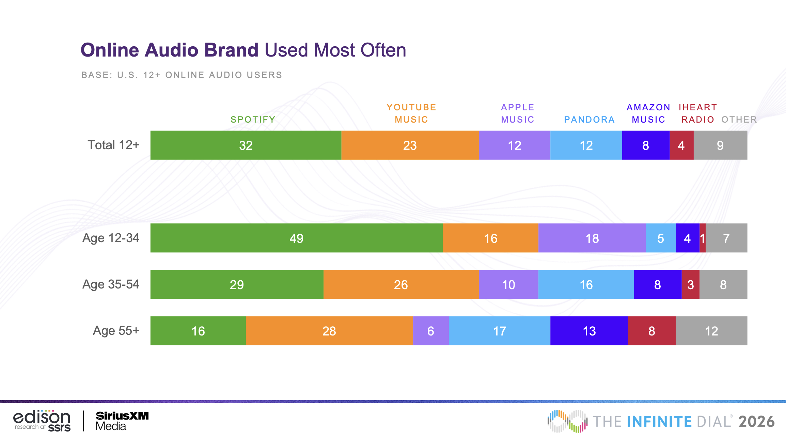

# Transpose: Problem Framing

## Domain

_An explanation of the domain, or general area, in which the problem lies._

As of 2025, Spotify consisted of 31.4% of global music subscriptions, Apple Music of 12.6%, and YouTube Music of 12.4% ([Source](https://www.chartlex.com/blog/business/music-streaming-market-share-2026)). In 2026, 32% of the US population listened to Spotify, 23% to YouTube Music, 12% to Apple Music, and 12% to Pandora ([Source](https://www.edisonresearch.com/wp-content/uploads/2026/03/The-Infinite-Dial-2026-Presentation.pdf)).

[Source](https://www.edisonresearch.com/wp-content/uploads/2026/03/The-Infinite-Dial-2026-Presentation.pdf)

But sharing music across platforms is highly inconvenient: most users listen to music through playlists, and it is highly difficult to share a Spotify playlist, for instance, with someone who does not use Spotify. In fact, someone is unable to listen to a Spotify playlist at all unless they get a Spotify account, and even if they do make an account, they're unable to even choose the order in which to play the music in a playlist ([Source](https://community.spotify.com/forum/en/discussion/5268490/share-spotify-playlist-to-non-spotify-user)).

Since no music platform fully dominates the whole population, friends often end up using different music platforms, so it's difficult to share music with friends.

## Bad situations

_One or more bad situations that arise in the domain and that call for a design intervention._

Music is a powerful tool for connection, and being unable to share music effectively removes that tool from us.

This bad situation affects me personally, as well. My family has YouTube Premium, while many of my friends have Spotify Premium. None of us are willing to switch platforms because it’s cheaper and more convenient to stick with what we currently have. After all, family plans are far cheaper than individual plans, and if I were to switch platforms, I'd also want to convince my entire family to switch platforms, too--a task that's far easier said than done.

## Evidence

_Evidence to corroborate the claim that the bad situations are impactful._

## Workarounds and comparables

_Workarounds that people currently use to mitigate the bad situations, and comparable solutions if they exist._

- [TuneMyMusic](https://www.tunemymusic.com/) -- a third-party website that allows you to transfer your music library from any music service to any other you want! Supports Spotify, TIDAL, Apple Music, YouTube, Amazon Music, Deezer and many more.
- [Soundiiz](https://soundiiz.com/) -- another, similar third-party website for transferring music from one platform to another

The main thing that differs between what we're suggesting and what these websites above solve is the following: our solution creates a way for friends to collaboratively build up a playlist, while the solutions above are more about one-time transfers from one platform to another, or one-time sharing of music.

## Solution sketch

_An outline of a solution._

## Ethical analysis

_An identification of stakeholders and the impacts they might experience in the short and long term._
